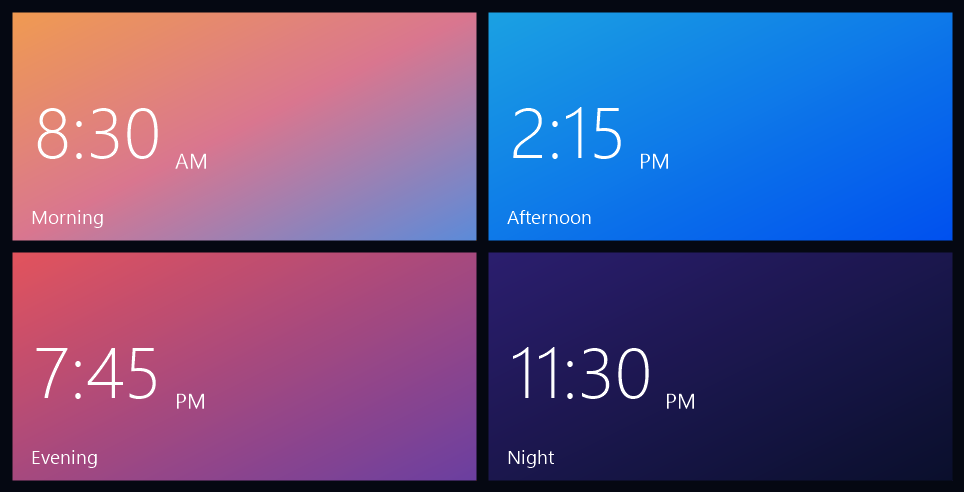

# Custom TV Launcher (Tiles)

A lightweight Windows Phone style home screen for Android TV, written for low-end TVs (1 GB of RAM).
Every app is a flat tile in its own colour, the clock is a live tile, and the whole layout can be rearranged
from the remote.


| The clock tile flips to show the day | OK on the clock opens a full-screen clock |
|---|---|
|  |  |

The clock tile's colour follows the time of day:



## Features

- **Tiles in four sizes**: small, medium, wide and large, packed Windows Phone style on a 10-unit grid (5 medium
  tiles per row).
- **Arrange it from the remote**: hold **OK** on a tile (or press **Menu**) to move, resize or hide it, show hidden
  apps again, open App info, or reset the layout. The layout is saved on the TV.
- **A live clock tile**, 12-hour with AM/PM. Every 15 seconds it flips over to show the day and date, and its
  colour follows the time of day (sunrise, afternoon blue, sunset, night). **OK** on it opens a full-screen clock
  that drifts slightly every minute so nothing burns into the panel.
- **A curated palette**: Windows Phone's Metro colours at matched intensity. Apps without a set colour get the
  palette colour nearest to their own artwork, so new apps fit in.
- **Icons that belong together**: flat white glyphs for common apps, glyphs in a brand colour where that reads
  better (Netflix's red N on black), and official logos turned into white silhouettes (Prime Video). Other apps
  keep their own icon.
- **A centred layout**: the greeting, the buttons and the tiles sit together in the middle of the screen. With
  more apps than fit, the header stays fixed at the top while the tiles scroll under it.
- **TV-sized text**: 20 sp tile names, readable from the sofa.
- **A greeting** (good morning / afternoon / evening / night) and a subtle black-to-navy background.
- **Two small top buttons**, Inputs and Wi-Fi (showing the network name), plain text until selected, then a white
  pill. No glass, blur or shadows anywhere.
- **Predictable D-pad navigation**: the ends of the top bar don't fall through to the tiles, and focus survives the
  remote's mouse mode (Android "touch mode").
- **Number keys** open apps: 1-9 the tiles in order, 0 the tenth.
- **An idle clock**: after 10 minutes untouched on Home, the full-screen clock appears by itself (never over an
  app or a video); any button closes it.
- **Windows Phone touches**: the selected tile dips while OK is held, and the tiles unfold into place in a quick
  sweep when Home comes back from an app.

## Lightweight

Plain Java and the Android framework's own views: no AndroidX, no libraries, no network access, no background
services. The APK is about 90 KB. Icons and colours are loaded once and only reloaded for apps that changed;
each icon is drawn once into a bitmap at its tile size. The background and the clock tile's gradients are each
drawn once into a tiny bitmap that the GPU stretches: computing a full-screen gradient per pixel cost this TV
about 5 ms a frame, the stretched bitmap nothing measurable. The tile entrance is a plain 2D scale: a fade with
per-tile layers and a 3D turn were both measured janky on this TV, while the 2D unfold returns Home exactly as
smoothly as no animation at all. The extras only run on a key press or when Home comes back; nothing polls.

Measured on the TV it was built for (HiSilicon Hi3751V350, Android 12, 1 GB RAM), compared with the launcher it
replaced, for the same 13 remote presses:

| | Tiles | Previous launcher |
|---|---|---|
| Cold start | 0.68 s | 1.16 s |
| Frame time, median / 90th percentile | 8 / 10 ms | 19 / 22 ms |
| Janky frames | 0 | 4 |
| Memory (PSS) | 23.5 MB | 25.0 MB |

## Requirements

- An Android TV device on Android 8.0 (API 26) or newer, with USB or network debugging switched on
- To build: JDK 17 (Android Studio's bundled `jbr` works) and the Android SDK with platform 34

## Build

```bash
cd tiles
./gradlew assembleRelease
```

The APK is `tiles/app/build/outputs/apk/release/app-release.apk` (signed with the debug key; it is meant for
sideloading, not for a store).

## Install

With [adb](https://developer.android.com/tools/adb):

```bash
adb connect <tv ip>:5555
adb install -r tiles/app/build/outputs/apk/release/app-release.apk
adb shell pm grant com.tvtiles.home android.permission.ACCESS_FINE_LOCATION
adb shell cmd package set-home-activity --user 0 com.tvtiles.home/.MainActivity
```

The location permission is only there because Android hides the Wi-Fi network name without it.

On Windows, `install-tiles.ps1` builds and installs in one step. It uses the ADB tools from
[cleanyourtv](https://github.com/Gathin23/cleanyourtv) (a pure-Python ADB client, more reliable than `adb push`
on some TVs): clone it into this folder as `cleanyourtv/` and set up its `tools/venv` as its README describes, then
run `.\install-tiles.ps1 -TvHost <tv ip>`. `-NoHome` installs without pressing Home (someone is watching).

## Customise

Everything TV-specific is in `tiles/app/src/main/res/values/config.xml`:

| Key | What it sets |
|---|---|
| `inputs_component` | What the Inputs button opens. The default is the source menu of Cultraview/HiSilicon TVs; other TVs fall back to Android's standard input picker |
| `default_layout` | Tile order and sizes on first start, as `package:size` (`clock` is the clock tile) |
| `excluded_packages` | Apps never shown, such as other launchers |
| `tile_palette` | The colours tiles are drawn from; a sampled app colour snaps to the nearest one |
| `tile_colors` | A colour per app, taking precedence over the palette |
| `tile_icons` | A white glyph (`res/drawable/ic_tile_*.xml`) instead of the app's own icon |
| `tile_glyph_colors` | A glyph drawn in a colour instead of white (Netflix's red N) |
| `tile_icons_white` | Apps whose own icon is shown as a white silhouette (Prime Video) |
| `tile_labels` | A tile name instead of the app's own |
| `clock_gradients` | The clock tile's colours for morning, afternoon, evening and night (two or three colours each) |
| `clock_color`, `clock_flip_seconds` | The clock tile's fallback colour, and how often it flips (0 keeps it still) |
| `number_shortcuts` | Number keys open the app tiles (on by default) |
| `idle_clock_minutes` | Minutes untouched on Home before the full-screen clock appears (10; 0 turns it off) |
| `press_tilt` | The selected tile dips while OK is held (on by default) |
| `tile_entrance` | The tiles unfold when Home comes back from an app (on by default) |
| `greeting_name` | A name after the greeting |
| `background_colors` | The background gradient |

## Credits

- [Outfit](https://github.com/Outfitio/Outfit-Fonts) font, SIL Open Font License 1.1 (`tiles/FONT-LICENSE-OFL.txt`)
- Several glyphs are based on [Material Icons](https://fonts.google.com/icons), Apache License 2.0 (noted in each file)
- The debloating and ADB tooling around it come from [cleanyourtv](https://github.com/Gathin23/cleanyourtv)

App names and brands shown on tiles belong to their owners; the glyphs are simplified symbols, not their logos.

## Licence

The launcher's code is released under the [MIT License](LICENSE). The bundled Outfit font keeps its own SIL Open
Font License, and the glyphs based on Material Icons keep the Apache License 2.0.
